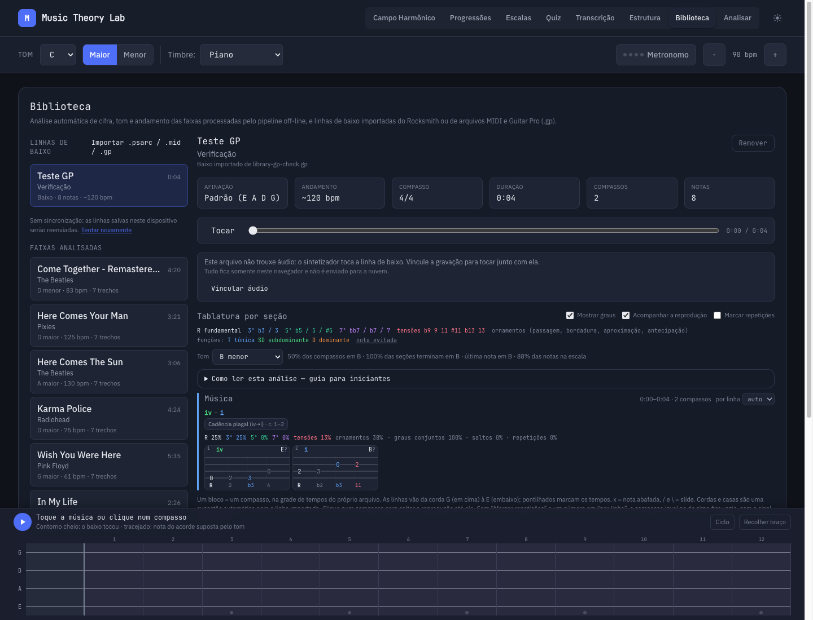

# Biblioteca imports

Biblioteca accepts Rocksmith 2014 `.psarc`, MIDI `.mid`/`.midi`, and Guitar
Pro 7/8 `.gp` files. GP6 `.gpx` and older `.gp3`/`.gp4`/`.gp5` formats are
not accepted by this flow.

Guitar Pro scores are parsed with alphaTab and exported internally to MIDI
in playback order, including repeats, alternate endings, ties, and tempo
changes. The existing MIDI bass-channel selector and arrangement adapter
then build the same `BassChart` used by MIDI and Rocksmith. Degrees, key
suggestions, harmonic functions, cadence analysis, tabs, the fretboard and
sampled-bass playback all consume that chart. Bass notes on Guitar Pro's
secondary bend channel stay with their primary track.

For four-string GP bass scores, the adapter keeps the score's actual tuning
and stores the original string/fret positions alongside the suggested
fingering. “Digitação” defaults to “Original do GP” and can switch to
“Sugerida pelo Music Lab”; both views have identical pitches, timing and
analysis evidence. The original positions synchronize with the derived chart.
Older GP imports need to be reimported once to recover their positions from
the source file. Reimporting updates the same chart without removing linked
audio. If any note cannot be matched faithfully to a plain string/fret position
(for example, generated ornament notes or harmonics), only the suggested
view is available. Guitar Pro's full articulation notation is not preserved.
Only the bass part feeds these analyses. The file's other instrument parts
are not additional harmony evidence.

## Guitar charts

Each GP track with a stringed staff of 5 or more strings that is not the bass
track gives one guitar chart (`part: 'guitar'`), with the track name as its
part name. Keys, strings, winds, and other instruments give no chart. A file
with a guitar track and no bass or drums imports.

- A guitar is not the bass: when the bass pick falls on a guitar track with no
  General MIDI bass program, the pick is made again without the guitar tracks.
- The chart keeps `strings`, `openPitches` (absolute MIDI, lowest string
  first, GP transposition removed), and `capo`. Each note keeps its GP string
  (0 is the lowest) and its fret, counted from the capo as in Guitar Pro:
  `midi = openPitches[string] + capo + fret`. Notes are read from the score,
  not from the MIDI export, so no fingering is guessed.
- Its id is a hash of the file hash, `guitar`, and the GP track index
  (`partChartId`). Bass and drum ids do not change, so a reimport keeps their
  linked audio and settings.
- `GuitarPartDetail` reuses `BassTabBar` with `strings` and `bends`. It shows a
  "Capo n" tag, stacks the notes of a beat, and shows degrees with "Mostrar
  graus" from the bar analysis of the guitar line.
- `parseGuitarChart` (in `bassChartRecord.ts`) validates the chart on the
  client and in `/api/bass-charts`. `CHART_SYNC_FORMAT` is 3, so a device that
  skipped a guitar record reads it after the update.

## Vocal charts

Each GP track with General MIDI program 53, 54, or 55, or a name that contains
"voc", "voz", or "voice", gives one vocal chart (`part: 'vocals'`), with the
track name as its part name. A vocal track is never a guitar or the bass. A file
with a vocal track and no bass or drums imports.

- The chart keeps the melody notes (`midi`, `time`, `bar`, `beatInBar`) and the
  lyric syllable of the beat (`lyric`, null when the score has none). All notes
  stay, also notes that sound at once. A track with no lyrics imports with the
  melody only.
- Its id is a hash of the file hash, `vocals`, and the GP track index
  (`partChartId`).
- `VocalPartDetail` draws the notes on a pitch lane, bar by bar, with the note
  name above each note and the lyrics under it. With "Mostrar graus" on, each
  note shows its degree in the key of the bass chart of the same file
  (`bassKeyOf`). Vocals never feed the bar analysis or the key. The dock keeps
  the bass fretboard.
- `parseVocalChart` (in `bassChartRecord.ts`) validates the chart on the client
  and in `/api/bass-charts`. `CHART_SYNC_FORMAT` is 4.

## Transposition

MIDI and GP charts without a linked recording have “−½ tom” and “+½ tom”
controls, up to an octave in either direction. Each click shifts the chord
names, analysis key, bass notes, tabs, fretboard and sampled-bass playback.
Playback keeps its position when the transposition changes. The
transposition and the tuning are saved for each chart in the chart settings,
together with the bar octaves. “Tom original” resets them; the saved import
stays unchanged.

While transposed or in a different tuning, GP fingering is recalculated and
the original/suggested picker is disabled. Returning to the original pitches
and tuning restores the user's selected fingering view.

Fingering is recalculated in the original tuning, which never changes
automatically. For standard E–A–D–G imports, “Afinação para tocar” offers an
explicit E Standard (E–A–D–G) or Drop D (D–A–D–G) choice. Only the E string
is lowered for Drop D. The entire line retains its transposed register when
it fits the selected tuning's playable range (0–24 frets). Otherwise it moves
by a common octave offset, preserving every interval. For example, lowering
an E1–E2 octave riff by one semitone gives Eb2–Eb3 in E Standard and Eb1–Eb2
in Drop D. The view reports the whole-line octave shift. If no common octave
fits, that transposition or tuning choice is disabled rather than changing
the line's intervals. Sampled playback shifts the available samples to each
note's exact pitch, preserving octaves beyond the sample range. Tuning can change
independently at any transposition, including for nonstandard imports.
“Tom original” restores both the pitches and imported tuning. Linked
recordings such as Ogg or MP3 disable these controls, and Rocksmith charts
do not expose them. “Tom para análise” still chooses the harmonic
interpretation independently of transposition.

## Persistence

Derived charts synchronize to the existing Turso database through
`/api/bass-charts`, using the same shared single-user library model as
transcriptions and Library annotations. The route creates its table on first
use with the deployment's existing `TURSO_DATABASE_URL` and
`TURSO_AUTH_TOKEN`; no extra credentials or manual migration are required.

The browser keeps charts in IndexedDB and uploads titles, artists, album,
source filename, tuning, timing, sections and bass notes. Original imported
files and extracted or attached recordings are not uploaded. On another
device the chart can play through the existing sampled bass without its
recording. The line lengths, the bar octaves, and the transposition sync with
the chart settings. The view mode and manually chosen analysis keys stay
local.

Existing browser imports migrate into the sync journal on first use. Sync
runs when Biblioteca opens, after importing or deleting, on focus or
reconnection, and every 30 seconds while Biblioteca is visible. Failed
requests retain local data for retry and show the unsynchronized status.
Timestamped deletion records prevent an offline device from restoring a
removed chart. Server and client validate charts before applying them.

## Verification

Run `npm test` and `npm run build`. Focused checks:

```sh
npx vitest run src/services/gp/importGpChart.test.ts src/services/bassChartSync.test.ts api/bass-charts.test.ts
```

Import a `.gp` in Biblioteca, enable “Mostrar graus” and play the chart.
Check that it remains available after reloading and appears on a second
device after deployment. A linked recording is local to its device.


