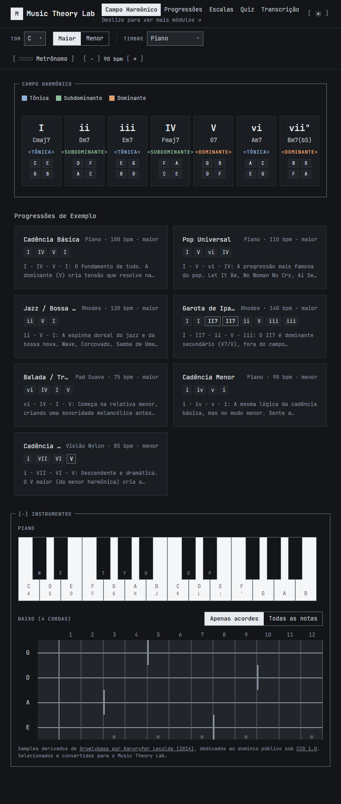
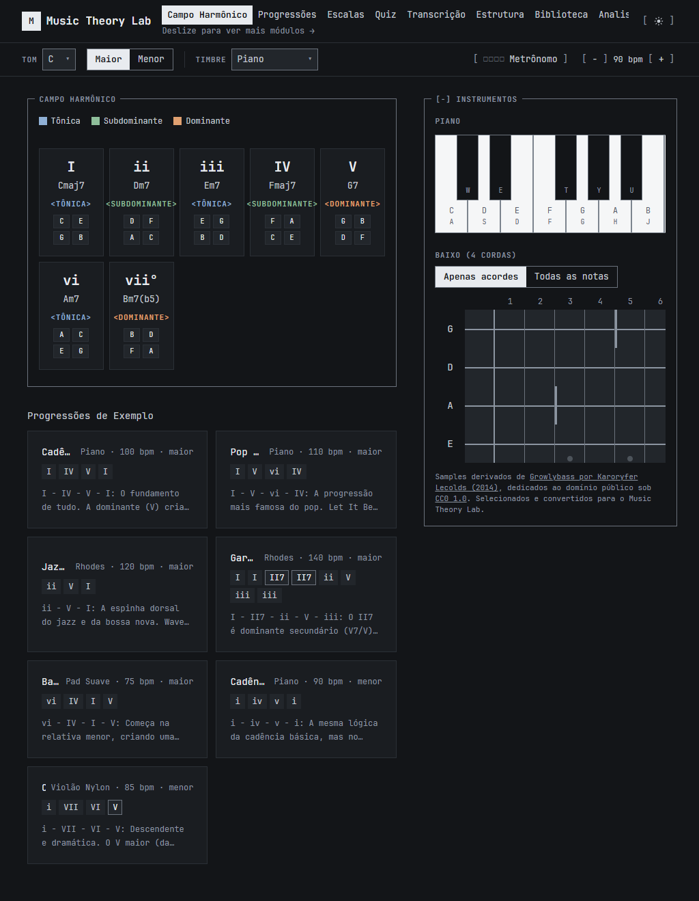

# iPad touch review evidence

These screenshots were captured by the local browser review at viewport widths
768 and 1024. They show the app shell and navigation; they are desktop browser
captures, not photographs of real-device acceptance checks.

The current application source matches the device-tested 808485e baseline.
The user confirmed smooth playback in the installed Home Screen app on an
iPad Air M3, and reported the remaining device checks as good before finding
the lock/unlock failure. The full device acceptance is not complete:

- [Audio fails after locking and unlocking](https://github.com/filipepacheco/music-theory-lab/issues/82).
- [GP playback stutters in Safari tabs](https://github.com/filipepacheco/music-theory-lab/issues/83).

The unverified pending-start retry experiment is excluded. The retained
implementation passes 905 tests and the production build. Desktop tablet
interaction checks and Chrome offline reload/audio checks also passed during
the software validation.
